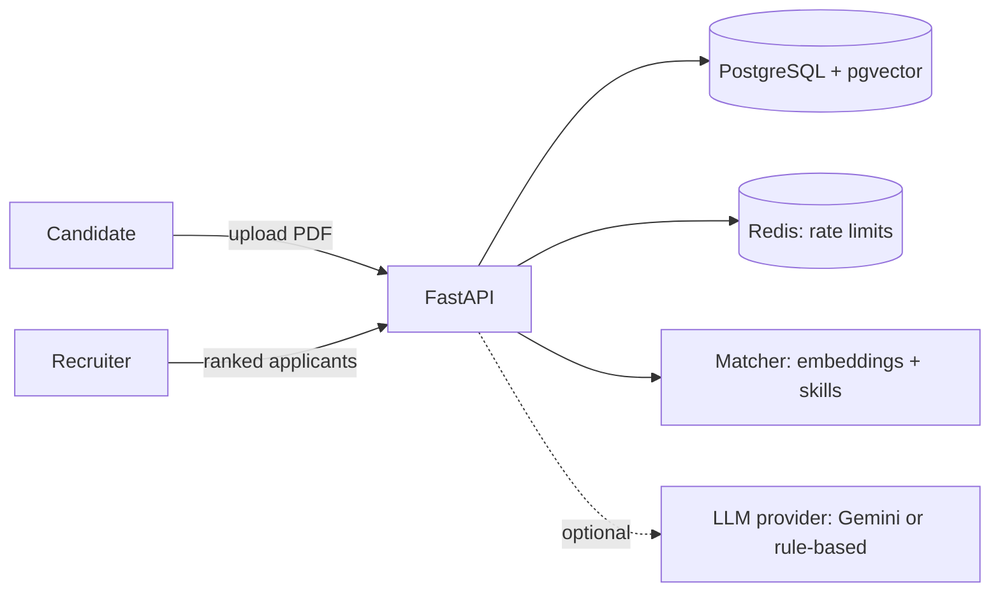

# Resume Matcher API

Multi-tenant backend for ranking job applicants. Candidates upload PDF resumes,
the system scores them against a job description, and recruiters see a ranked
list with a breakdown of why each person ranked where they did.

## Features

- **Hybrid scoring:** semantic similarity (local sentence-transformers embeddings)
  combined with explicit skill matching. Runs on CPU, no paid API required.
- **Multi-tenant:** every record belongs to an organization, and every query is
  filtered by it. One company can never see another's data (covered by tests).
- **Role-based access:** admin, recruiter, candidate.
- **Explainable results:** each score stores its breakdown (matched and missing skills).
- **Background scoring:** uploads return immediately, scoring runs off the request path.
- **Privacy tools:** candidates can delete their account and resume data.
- **Swappable AI provider:** optional LLM explanations behind a provider interface,
  with a no-API rule-based fallback.

## Architecture



Request flow: `POST /jobs/{id}/apply` validates and parses the PDF, saves the
application, then scores it in a background task. Recruiters call
`GET /jobs/{id}/applications` to get applicants ordered by score.

## Stack

FastAPI, Pydantic v2, SQLAlchemy 2.0, Alembic, PostgreSQL (pgvector image),
Redis, sentence-transformers (CPU PyTorch), argon2 password hashing,
JWT auth, pytest, Docker Compose.

## Quick start

```bash
cp .env.example .env        # then set real values
docker compose up -d --build
```

API docs: http://127.0.0.1:8000/docs, health check: `/health`.
Migrations run automatically when the API container starts.

### Local development

```bash
python3 -m venv venv && source venv/bin/activate
pip install torch --index-url https://download.pytorch.org/whl/cpu
pip install -r requirements.txt
docker compose up -d db redis
export PYTHONPATH=.
alembic upgrade head
uvicorn app.main:app --reload
```

### Tests

```bash
docker compose up -d db redis
pytest -v
```

Tests run against a separate `resume_matcher_test` database.

## API overview

| Method | Path | Role |
|---|---|---|
| POST | /auth/register-org | public (creates org and first admin) |
| POST | /auth/register-candidate | public |
| POST | /auth/login | public (rate limited) |
| GET | /auth/me | any |
| DELETE | /auth/me | candidate (erases account and resumes) |
| POST | /jobs | admin, recruiter |
| GET | /jobs | any (own org only) |
| POST | /jobs/{id}/apply | candidate |
| GET | /jobs/{id}/applications | admin, recruiter (ranked) |
| PATCH | /jobs/applications/{id}/stage | admin, recruiter |

## Security and compliance notes

- Passwords hashed with argon2. Short-lived JWT access tokens.
- Login is rate limited per IP and email using Redis.
- Org scoping on all data access, with an automated isolation test.
- Scores use resume content only. Name, gender, age and photo are not inputs.
- Scores support recruiters. A human makes the hiring decision.
- Hiring AI is regulated in many places (GDPR, EU AI Act, NYC Local Law 144,
  Kenya Data Protection Act). Buyers should complete their own legal review.

## Known limitations and roadmap

- Scanned (image-only) PDFs are rejected. OCR is planned.
- Skill list is global and hardcoded. Per-organization skill lists are planned.
- Background tasks run in-process. Moving to a Redis worker queue (ARQ) adds
  retries and horizontal scaling.
- Default embedding model is English-focused. Use a multilingual model
  (paraphrase-multilingual-MiniLM-L12-v2) for other languages.
- Refresh tokens, email verification and password reset are not implemented yet.
- Behind a reverse proxy, rate limiting needs the forwarded client IP.
