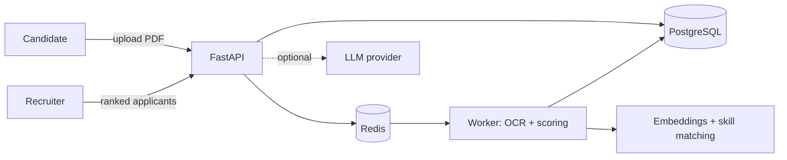

# Resume Matcher API

[](https://github.com/Millan-juma/resume-matcher/actions/workflows/ci.yml)

Multi-tenant backend for ranking job applicants. Candidates upload PDF resumes
(including scans), the system scores them against a job description, and
recruiters see a ranked list with a breakdown of why each person ranked where
they did.

## Features

- **Hybrid scoring:** semantic similarity (local sentence-transformers embeddings)
  combined with explicit skill matching. Runs on CPU, no paid API required.
- **Per-organization skill lists:** each company defines the skills that matter to
  it. Built-in defaults apply until it does.
- **Scanned PDFs:** OCR with Tesseract, run on your own server. Nothing is sent
  to a third party.
- **Reliable background processing:** scoring runs in a worker (RQ + Redis) with
  automatic retries. Each application records its scoring status and failure
  reason. If Redis is down, the API falls back to in-process tasks.
- **Multi-tenant:** every record belongs to an organization and every query is
  filtered by it. One company can never see another's data (covered by tests).
- **Roles:** admin, recruiter and candidate. Admins manage staff, and can
  deactivate a leaver instantly.
- **Account security:** argon2 password hashing, short-lived JWT access tokens,
  rotating refresh tokens with reuse detection, logout and logout-all, password
  reset with a pluggable email sender, and Redis-backed rate limiting.
- **Explainable results:** every score stores its breakdown. Optional AI
  explanations sit behind a swappable provider, with a no-API rule-based default.
- **Privacy tools:** a candidate can erase their account, which also removes
  their applications, resume text, stored scans, cached AI explanations and sessions.

## Architecture



Request flow: `POST /jobs/{id}/apply` validates the PDF and saves the
application, then queues a scoring job. The worker extracts text (OCR for
scans), scores it, and records the result. Recruiters call
`GET /jobs/{id}/applications` for applicants ordered by score.

## Stack

FastAPI, Pydantic v2, SQLAlchemy 2.0, Alembic, PostgreSQL (pgvector image),
Redis, RQ, sentence-transformers (CPU PyTorch), Tesseract, argon2, JWT, pytest,
Docker Compose, GitHub Actions.

## Quick start (Docker)

```bash
cp .env.example .env        # then set real values (database password, SECRET_KEY)
docker compose --profile app up -d --build
```

API docs: http://127.0.0.1:8000/docs, health check: `/health`.
Migrations run automatically when the API container starts.

`docker compose up -d` without the profile starts only PostgreSQL and Redis,
which is what you want for local development.

## Local development

```bash
python3 -m venv venv && source venv/bin/activate
pip install torch --index-url https://download.pytorch.org/whl/cpu
pip install -r requirements.txt --extra-index-url https://download.pytorch.org/whl/cpu
sudo apt install tesseract-ocr        # for scanned PDFs
docker compose up -d                  # PostgreSQL and Redis only
export PYTHONPATH=.
alembic upgrade head
uvicorn app.main:app --reload         # API
python -m app.workers.worker          # worker, in a second terminal
```

Set `QUEUE_MODE=inline` in `.env` to skip the worker and process in the API
process while developing.

## Tests

```bash
docker compose up -d
pytest -v
```

Tests use a separate `resume_matcher_test` database. CI runs lint, applies the
migrations to an empty database, checks they match the models, runs the tests,
and builds and starts the full Docker stack on every push.

## API overview

| Method | Path | Who |
|---|---|---|
| POST | /auth/register-org | public (creates the org and its first admin) |
| POST | /auth/register-candidate | public |
| POST | /auth/login | public (rate limited) |
| POST | /auth/refresh | refresh token (rotating) |
| POST | /auth/logout, /auth/logout-all | refresh token / signed in |
| POST | /auth/forgot-password, /auth/reset-password | public (rate limited) |
| GET, DELETE | /auth/me | signed in (DELETE: candidate, erases the account) |
| POST, GET | /users/staff | admin |
| POST | /users/{id}/deactivate, /users/{id}/reactivate | admin |
| GET, POST, DELETE | /skills, /skills/{id} | admin, recruiter |
| POST, GET | /jobs | admin, recruiter / any in the org |
| GET | /jobs/{id} | any in the org |
| POST | /jobs/{id}/apply | candidate (PDF, scans supported) |
| GET | /jobs/{id}/applications?limit=&offset= | admin, recruiter (ranked) |
| POST | /jobs/{id}/rescore?only_unfinished= | admin, recruiter |
| PATCH | /jobs/applications/{id}/stage | admin, recruiter |
| POST | /applications/{id}/explain | admin, recruiter |
| GET | /applications/me | candidate (stage only, no scores) |

## Configuration

| Variable | Purpose |
|---|---|
| POSTGRES_USER, POSTGRES_PASSWORD, POSTGRES_DB, POSTGRES_HOST, POSTGRES_PORT | database |
| REDIS_URL | rate limiting and job queue |
| SECRET_KEY | JWT signing key (use a long random value) |
| QUEUE_MODE | `redis` (worker) or `inline` (in the API process) |
| OCR_LANGS | Tesseract languages, e.g. `eng+swa+fra` (install the packs too) |
| CORS_ORIGINS | comma-separated frontend origins |
| EMAIL_PROVIDER, SMTP_* | `console` prints emails (dev only), `smtp` sends them |
| LLM_PROVIDER, GEMINI_API_KEY, GEMINI_MODEL | optional AI explanations |

## Security and compliance notes

- Scores use resume content only. Name, gender, age and photo are not inputs.
- Scores support recruiters. A human makes the hiring decision.
- Candidates see their application stage but not their score or ranking.
- Emails and phone numbers are removed before any text goes to an AI provider.
  If a hosted provider is enabled, the rest of the resume text is sent to it.
  Review its data terms before using real candidate data.
- Hiring AI is regulated in many places (GDPR, EU AI Act, NYC Local Law 144,
  Kenya Data Protection Act). Buyers should complete their own legal review.

## Known limitations and roadmap

- OCR reads the first 5 pages. Accuracy depends on scan quality.
- Email addresses are unique across the whole system, so one person cannot hold
  accounts at two companies. A membership table would fix this.
- Access tokens stay valid for up to 15 minutes after logout or deactivation.
- Staff accounts are created by an admin with a password the admin sets. There
  is no invite email yet.
- No email verification. The register endpoints reveal whether an email exists.
- A scoring job running when the worker is killed is marked failed after its
  5-minute timeout. Recover with `rescore?only_unfinished=true`.
- The default embedding model is English-focused. Use a multilingual model
  (paraphrase-multilingual-MiniLM-L12-v2) for other languages.
- Each API process also loads the embedding model (for the inline fallback), so
  size RAM accordingly.
- Rate limiting uses the client IP. Behind a reverse proxy it needs the
  forwarded IP from a trusted proxy.
- Planned: web frontend, email verification, organization membership model.
